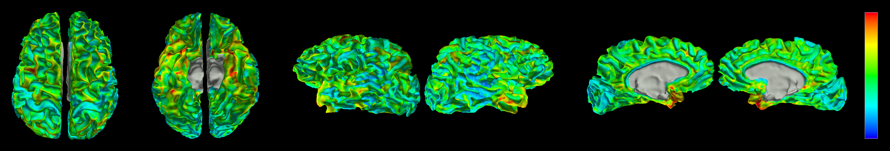

# sumaru documentation

Sumaru is an experimental Rust viewer for SUMA-style neuroimaging data.
Use it to inspect cortical surfaces, statistical overlays, timecourses, ROIs,
and volume slices, or to exchange selections with AFNI.



Start with [installation](installation.md) and the [quickstart](quickstart.md).
The user guide describes the current implementation; this is research software,
and compatibility with SUMA is still incomplete.

```{toctree}
:maxdepth: 2
:caption: Getting started

installation
quickstart
```

```{toctree}
:maxdepth: 2
:caption: User guide

viewer
overlays
timecourses
instacorr
surface-mapping
surface_alignment_walkthrough
afni
DRIVESUMA
```

```{toctree}
:maxdepth: 2
:caption: Project

development
documentation
license
```

Source code and issue reports: [pmolfese/sumaru on GitHub](https://github.com/pmolfese/sumaru).
